# StuDyIo

## Project Documentation

- [Download the Word documentation](docs/StuDyIo-Documentation.docx)
- [Download the PDF documentation](docs/StuDyIo-Documentation.pdf)

## Project Title

**StuDyIo** — Turn your student experience into a portfolio worth sharing.

## Project Description

StuDyIo helps students create an online portfolio from their education, skills, projects, work experience and contact details. Register and log in to keep portfolios private to their owner; no email verification is required. Enter information and save it to Supabase, choose one of three templates, then generate and preview the portfolio. Owners can edit or delete their portfolios later, and uploaded pictures and project screenshots are stored in Supabase Storage.

## Technologies Used

- Laravel 13.37 and PHP 8.4 in the production container (Composer requires PHP 8.3 or newer)
- Blade
- Tailwind CSS 4.3 and Vite 8.3
- PostgreSQL on Supabase
- Supabase Storage
- Brevo transactional email over HTTPS for password recovery
- Docker
- Render
- Git and GitHub

## Database Platform

Supabase (PostgreSQL), project **StuDyIo**, region **South Asia (Mumbai, ap-south-1)**. The app connects through the Supabase session pooler. Database credentials and the server-side Supabase Storage key are configured through environment variables and are not stored in this repository.

## Hosting / Deployment Platform

Render Web Service using Docker on the Free instance tier. After a period of inactivity, the first load can take about a minute while the service wakes.

## Database Structure

The tables below are defined by the Laravel migrations in database/migrations. PostgreSQL names and types are shown; “Yes” in the nullable column means NULL is allowed. Primary keys use the migration-generated sequence defaults. Timestamps created with timestampsTz are nullable timestamptz columns.

### Application tables

#### portfolios

| Column | Type | Nullable | Key / default |
|---|---|---:|---|
| id | bigserial | No | Primary key |
| user_id | bigint | Yes | Foreign key to users.id; delete cascades |
| full_name | varchar(160) | No | |
| profile_picture_path | varchar(1024) | Yes | |
| email | varchar(255) | No | |
| contact_number | varchar(60) | Yes | |
| address | text | Yes | |
| about_me | text | Yes | |
| template_id | bigint | Yes | Foreign key to templates.id; delete sets NULL |
| created_at | timestamptz | Yes | |
| updated_at | timestamptz | Yes | |

#### education

| Column | Type | Nullable | Key / default |
|---|---|---:|---|
| id | bigserial | No | Primary key |
| portfolio_id | bigint | No | Foreign key to portfolios.id; delete cascades |
| institution | varchar(180) | Yes | |
| qualification | varchar(180) | Yes | |
| field_of_study | varchar(180) | Yes | |
| start_date | date | Yes | |
| end_date | date | Yes | |
| description | text | Yes | |
| sort_order | smallint | No | Default 0 |
| created_at | timestamptz | Yes | |
| updated_at | timestamptz | Yes | |

#### skills

| Column | Type | Nullable | Key / default |
|---|---|---:|---|
| id | bigserial | No | Primary key |
| portfolio_id | bigint | No | Foreign key to portfolios.id; delete cascades |
| name | varchar(120) | No | |
| proficiency | varchar(60) | Yes | |
| sort_order | smallint | No | Default 0 |
| created_at | timestamptz | Yes | |
| updated_at | timestamptz | Yes | |

#### projects

| Column | Type | Nullable | Key / default |
|---|---|---:|---|
| id | bigserial | No | Primary key |
| portfolio_id | bigint | No | Foreign key to portfolios.id; delete cascades |
| title | varchar(180) | No | |
| description | text | Yes | |
| project_url | varchar(2048) | Yes | |
| screenshot_path | varchar(1024) | Yes | |
| sort_order | smallint | No | Default 0 |
| created_at | timestamptz | Yes | |
| updated_at | timestamptz | Yes | |
| tags | json | Yes | |

#### work_experience

| Column | Type | Nullable | Key / default |
|---|---|---:|---|
| id | bigserial | No | Primary key |
| portfolio_id | bigint | No | Foreign key to portfolios.id; delete cascades |
| company | varchar(180) | Yes | |
| role | varchar(180) | Yes | |
| start_date | date | Yes | |
| end_date | date | Yes | |
| description | text | Yes | |
| sort_order | smallint | No | Default 0 |
| created_at | timestamptz | Yes | |
| updated_at | timestamptz | Yes | |

#### social_links

| Column | Type | Nullable | Key / default |
|---|---|---:|---|
| id | bigserial | No | Primary key |
| portfolio_id | bigint | No | Foreign key to portfolios.id; delete cascades |
| platform | varchar(80) | Yes | |
| label | varchar(120) | Yes | |
| url | varchar(2048) | No | |
| sort_order | smallint | No | Default 0 |
| created_at | timestamptz | Yes | |
| updated_at | timestamptz | Yes | |

#### templates

| Column | Type | Nullable | Key / default |
|---|---|---:|---|
| id | bigserial | No | Primary key |
| slug | varchar(40) | No | Unique: simple, modern, creative |
| name | varchar(80) | No | |
| description | text | No | |
| sort_order | smallint | No | Default 0 |
| created_at | timestamptz | Yes | |
| updated_at | timestamptz | Yes | |

### Laravel authentication and framework tables

#### users

| Column | Type | Nullable | Key / default |
|---|---|---:|---|
| id | bigserial | No | Primary key |
| name | varchar(255) | No | |
| email | varchar(255) | No | Unique |
| email_verified_at | timestamp without time zone | Yes | |
| password | varchar(255) | No | Laravel password hash |
| remember_token | varchar(100) | Yes | |
| created_at | timestamp without time zone | Yes | |
| updated_at | timestamp without time zone | Yes | |

#### password_reset_tokens

| Column | Type | Nullable | Key / default |
|---|---|---:|---|
| email | varchar(255) | No | Primary key |
| token | varchar(255) | No | |
| created_at | timestamp without time zone | Yes | |

#### sessions

| Column | Type | Nullable | Key / default |
|---|---|---:|---|
| id | varchar(255) | No | Primary key |
| user_id | bigint | Yes | Indexed; no foreign key in the Laravel migration |
| ip_address | varchar(45) | Yes | |
| user_agent | text | Yes | |
| payload | text | No | |
| last_activity | integer | No | Indexed |

#### cache

| Column | Type | Nullable | Key / default |
|---|---|---:|---|
| key | varchar(255) | No | Primary key |
| value | text | No | |
| expiration | bigint | No | Indexed |

#### cache_locks

| Column | Type | Nullable | Key / default |
|---|---|---:|---|
| key | varchar(255) | No | Primary key |
| owner | varchar(255) | No | |
| expiration | bigint | No | Indexed |

#### jobs

| Column | Type | Nullable | Key / default |
|---|---|---:|---|
| id | bigserial | No | Primary key |
| queue | varchar(255) | No | Indexed |
| payload | text | No | |
| attempts | smallint | No | |
| reserved_at | integer | Yes | |
| available_at | integer | No | |
| created_at | integer | No | |

#### job_batches

| Column | Type | Nullable | Key / default |
|---|---|---:|---|
| id | varchar(255) | No | Primary key |
| name | varchar(255) | No | |
| total_jobs | integer | No | |
| pending_jobs | integer | No | |
| failed_jobs | integer | No | |
| failed_job_ids | text | No | |
| options | text | Yes | |
| cancelled_at | integer | Yes | |
| created_at | integer | No | |
| finished_at | integer | Yes | |

#### failed_jobs

| Column | Type | Nullable | Key / default |
|---|---|---:|---|
| id | bigserial | No | Primary key |
| uuid | varchar(255) | No | Unique |
| connection | varchar(255) | No | |
| queue | varchar(255) | No | |
| payload | text | No | |
| exception | text | No | |
| failed_at | timestamp without time zone | No | Default current timestamp |

#### migrations

| Column | Type | Nullable | Key / default |
|---|---|---:|---|
| id | bigserial | No | Primary key |
| migration | varchar(255) | No | |
| batch | integer | No | |

### Relationships

~~~mermaid
erDiagram
    USERS o|--o{ PORTFOLIOS : owns
    TEMPLATES o|--o{ PORTFOLIOS : styles
    PORTFOLIOS ||--o{ EDUCATION : includes
    PORTFOLIOS ||--o{ SKILLS : includes
    PORTFOLIOS ||--o{ PROJECTS : includes
    PORTFOLIOS ||--o{ WORK_EXPERIENCE : includes
    PORTFOLIOS ||--o{ SOCIAL_LINKS : includes
~~~

Deleting a user deletes their portfolios and the linked education, skills, projects, work experience and social links. Deleting a portfolio deletes all its child rows. Deleting a template leaves a portfolio in place and clears template_id. Row Level Security is enabled on every public table created by the migrations, with no policies; the Laravel server connects through the database pooler. The complete SQL reference, including framework tables, indexes, foreign keys, seeded templates and RLS statements, is in schema.sql. Supabase Storage is managed separately from the public PostgreSQL schema; the portfolio-assets bucket stores profile and project images.

## Screenshots of the System

Screenshots were captured from the published site using the seeded demo portfolio. The Supabase Table Editor capture shows the three public template rows.

**Home**

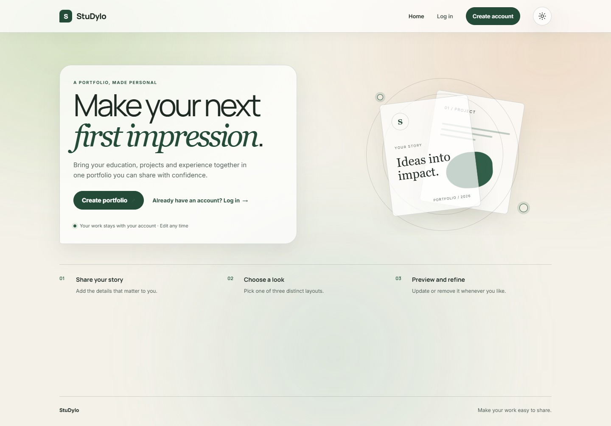

**Register**

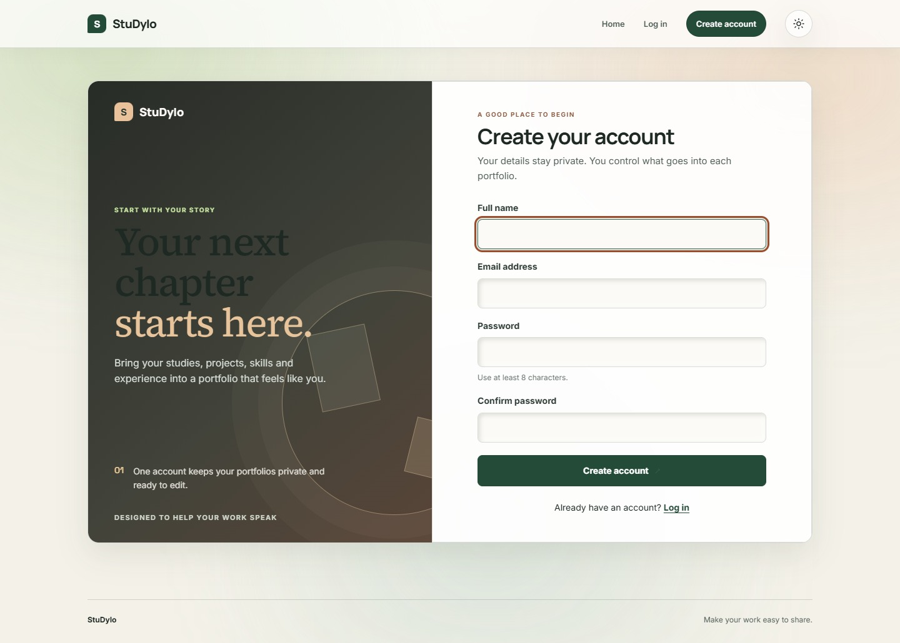

**Login**

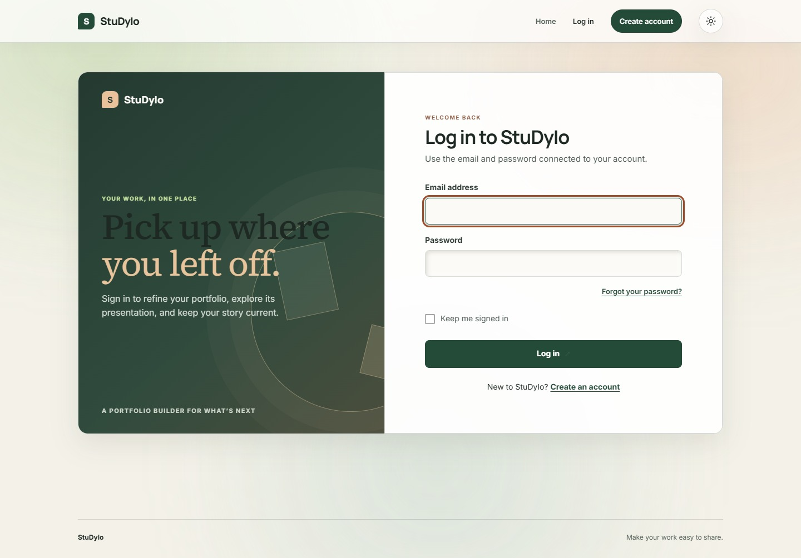

**Forgot Password**

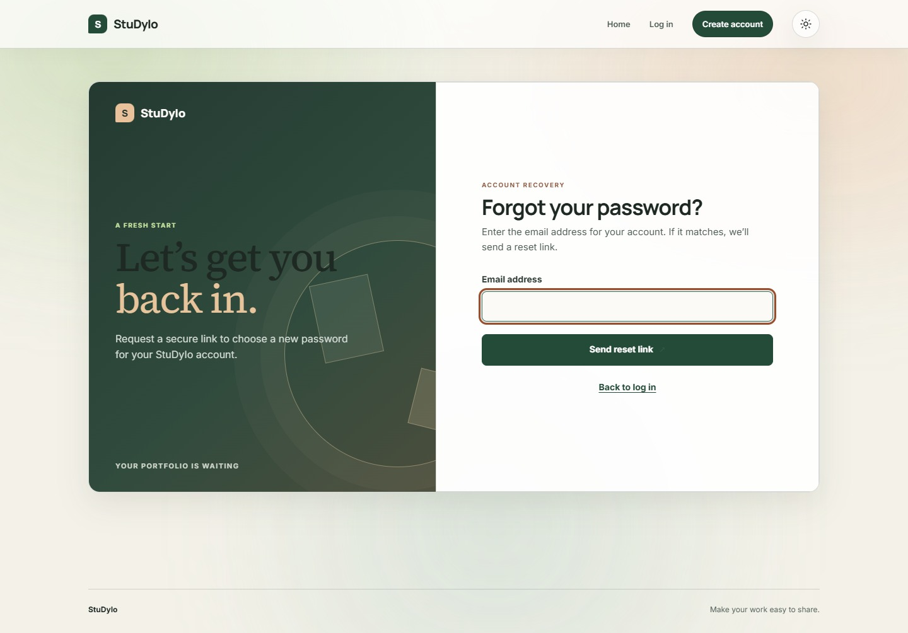

**Reset Password**

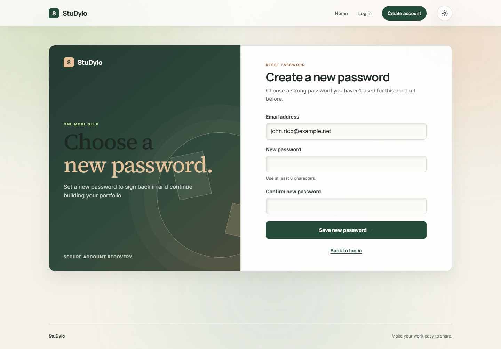

**Portfolio Information form**

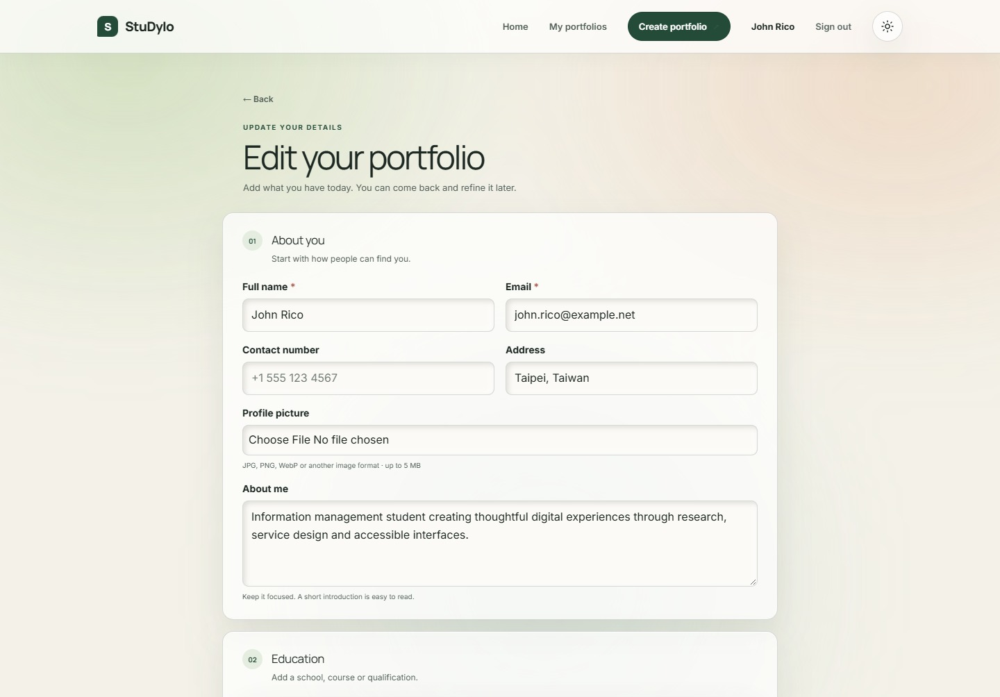

**Template Selection**

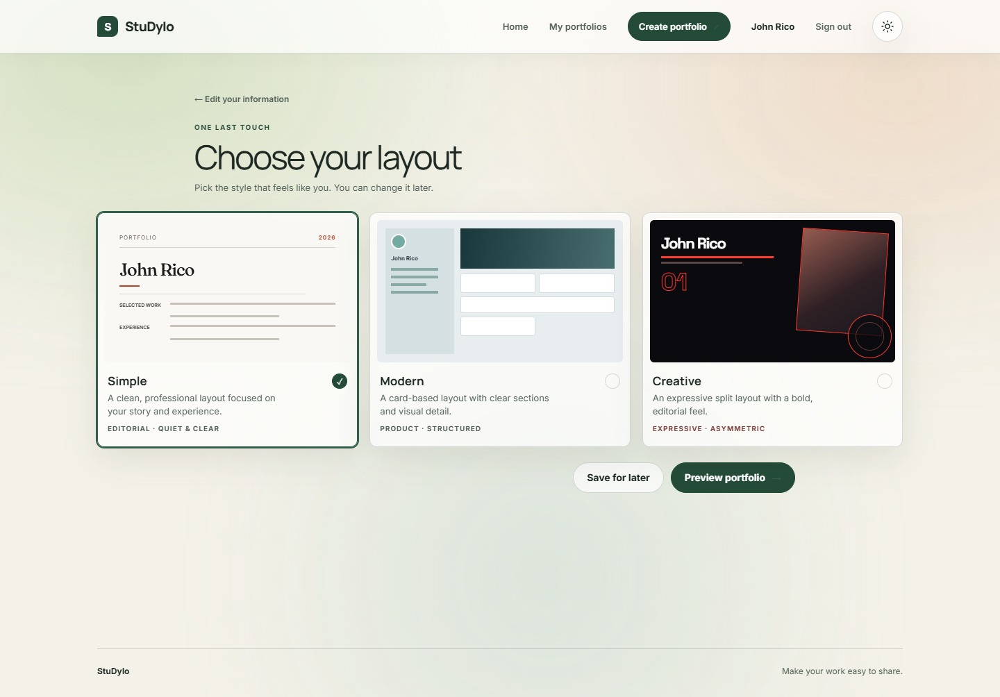

**Portfolio Preview**

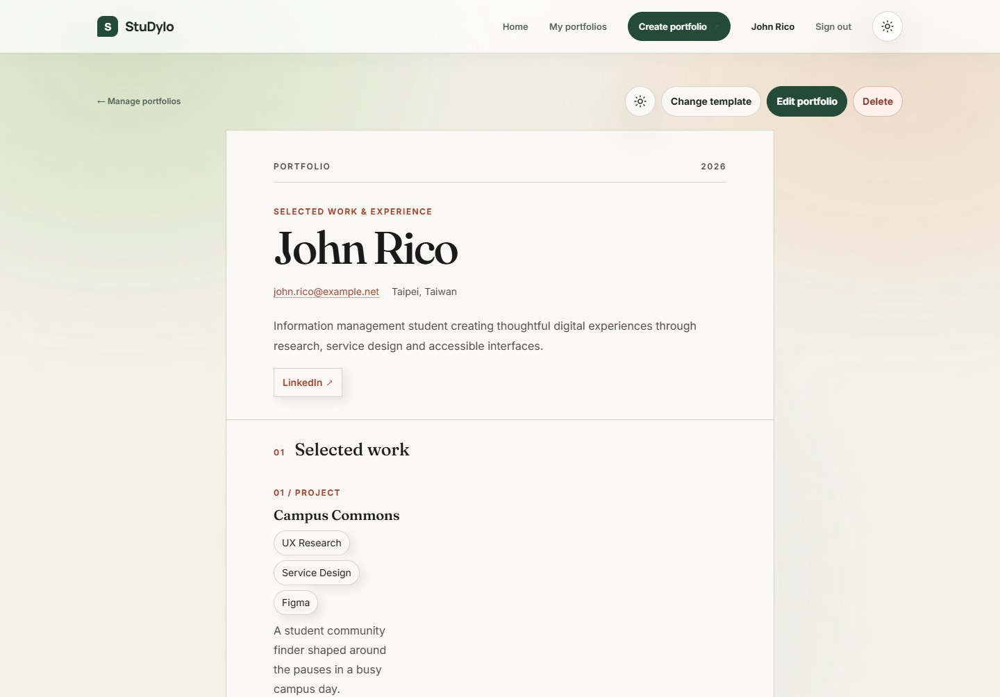

**Manage Portfolio**

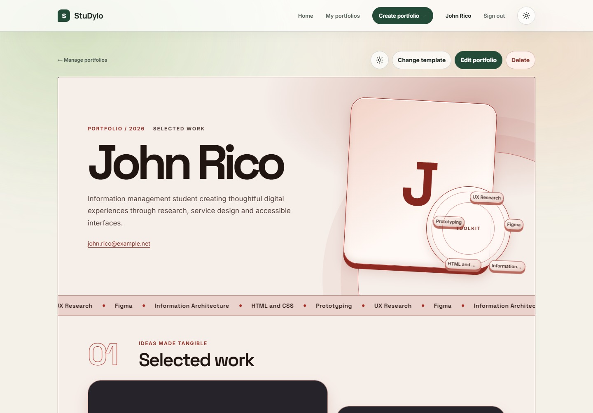

**Supabase Table Editor**

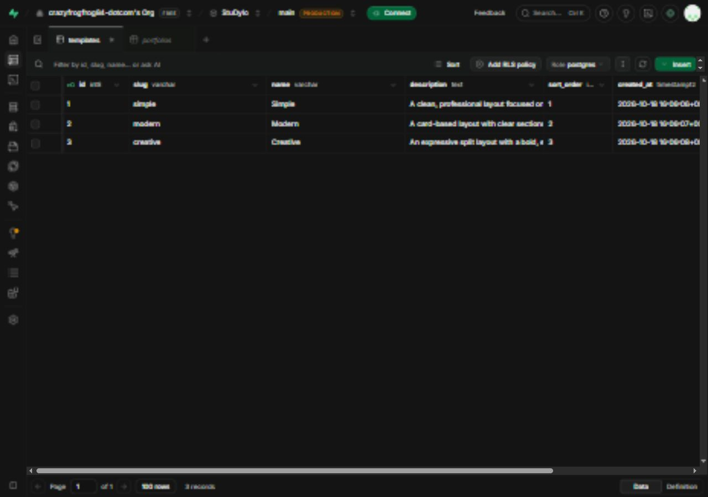

## Screenshots of the 3 Templates

**Simple**

| Light mode | Dark mode |
| --- | --- |
|  | 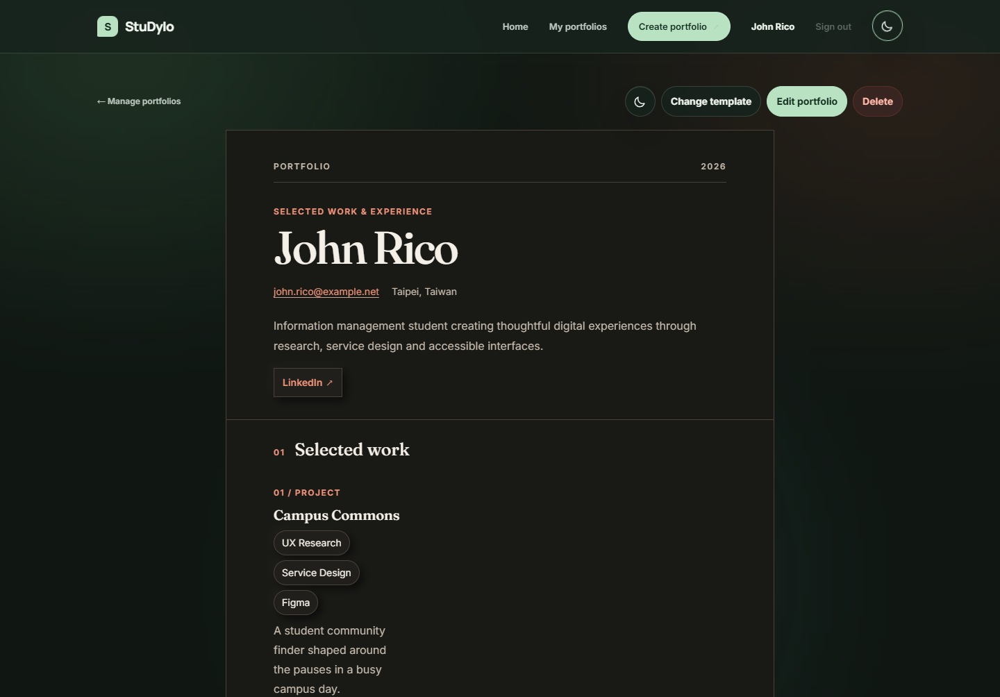 |

**Modern**

| Light mode | Dark mode |
| --- | --- |
| 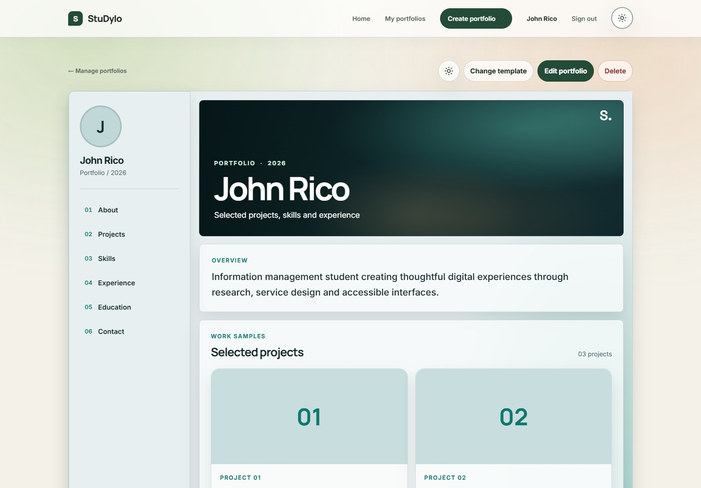 | 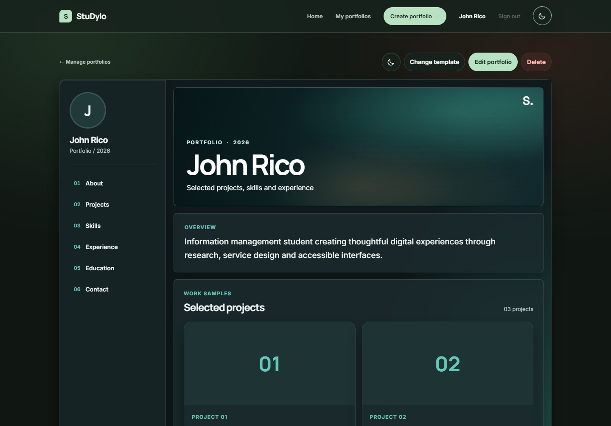 |

**Creative**

| Light mode | Dark mode |
| --- | --- |
|  | 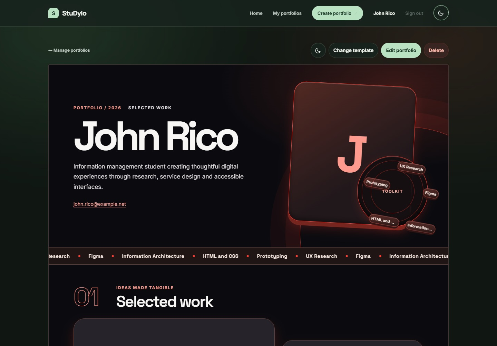 |

## Published Website URL

[https://studyio-portfolio.onrender.com](https://studyio-portfolio.onrender.com)

## Testing the system

If a password reset email does not arrive, check your spam or junk folder.

- Open the published website and choose Create account. Register with your own name, email and password; registration signs you in immediately and does not require email verification.
- Choose Create portfolio, enter the profile and portfolio information, and save. Add education, skills, projects, work experience, social links, a profile picture and project screenshots as needed.
- Choose Simple, Modern or Creative, generate the portfolio, then refresh the preview to confirm the saved information persists.
- Use Edit portfolio to change and save information. Use Delete and confirm the prompt to remove the portfolio and its linked rows.
- In the Supabase dashboard, open the StuDyIo project and Table Editor. Check public.portfolios and its child tables after saving; templates should contain exactly simple, modern and creative. After deletion, the portfolio and cascade-linked rows should be gone. The app database connection can access rows server-side; Supabase browser API roles have no RLS policies.

No throwaway demo login is published. Optional project notes: [build history](docs/build-history.md) and [design system](docs/design-system.md).
